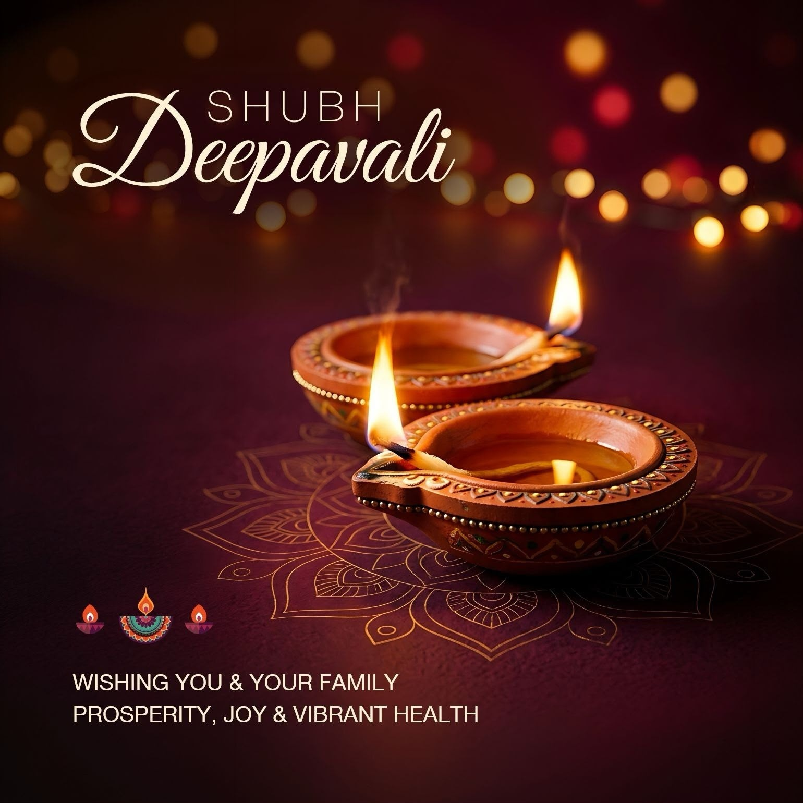

## Shubh Deepavali

*May the festival of lights bring light, health and prosperity to you and your family.*

To every reader of HCITExperts: thank you for being part of this community.

Diwali is a celebration with family. But in every hospital across India, it is also another working night. Emergency teams, burns units, ICU nurses, ambulance crews and the IT teams on call will be at work while the rest of us light the diyas. To all of you: thank you. You keep the lights on in more ways than one.

A few small requests for the evening:

- **Keep a bucket of water or sand nearby** when lighting diyas and crackers, and keep children at a safe distance.
- **For a burn, cool it under clean running water** and get medical help. Do not apply ice, toothpaste or oil.
- **If you or someone at home has asthma or a heart or lung condition,** keep medicines at hand and stay indoors when the smoke is heavy.
- **Check on an elderly neighbour** who may be celebrating alone.

The Clinical Frontier, our daily briefing on frontier AI in Indian healthcare, is back from today, and continues every afternoon at about 4 PM IST.

**Wishing you a very Happy, Safe and Prosperous Diwali**

Best wishes and regards, 
Manish 
Team HCITExperts

